# Mandorino — White-Label Lead-Tool für Anwaltskanzleien

Pro Deployment = **eine Kanzlei**. Mandanten schildern ihren Fall in einem
geführten Chat unter dem Branding der Kanzlei; das Team bearbeitet die
eingehenden Anfragen in einem internen Dashboard mit Status-Workflow,
Zuweisung, Notizen und Bearbeitungs-Priorität.

**Live-Demo:** https://mandorino.vercel.app — Demo-Tenant „Hartmann & Kollegen"
(fiktive Kanzlei, nur für Vorführungen).

> **RDG-Compliance:** Mandorino erbringt **keine** Rechtsdienstleistung.
> Es findet keine rechtliche Bewertung, keine Einschätzung von
> Erfolgsaussichten und keine Handlungsempfehlung statt. Die Bewertung
> übernimmt die Kanzlei im Anschluss. Diese Vorgabe ist im Code an mehreren
> Stellen verankert (UI-Disclaimer, Chat-Skript, KI-System-Prompt,
> Template-Fallback).

<p align="center">
  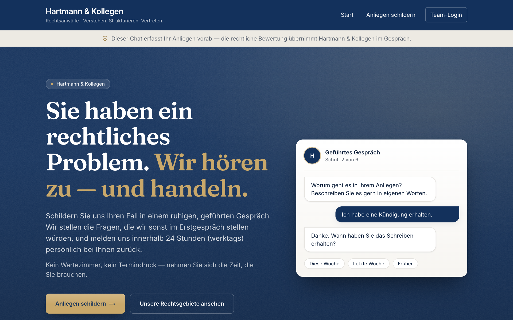
</p>

## Auf einen Blick

| Mandant:in — geführter Chat | Team — Dashboard & Workflow |
|---|---|
| 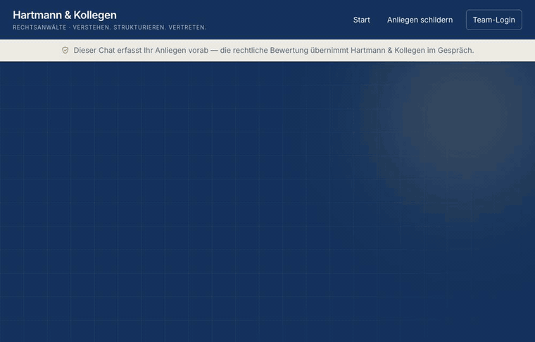 | 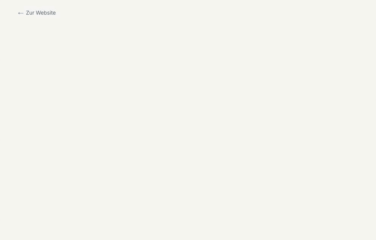 |

**Was dieses Projekt zeigt**

- **Produktdenken:** White-Label für Kanzleien, RDG-konform (keine Rechtsberatung) — vom Chat-Skript bis zum KI-Prompt.
- **Sicherheit statt Fassade:** Der Server baut jeden Lead selbst (Validierung, `insert` statt `upsert`, signierte KI-Zusammenfassung), `/team/*` wird per Middleware und Supabase-RLS geschützt, Rate-Limits pro IP und E-Mail, Embed-Allowlist per CSP.
- **Datenfluss mit Datenbank:** Supabase/Postgres mit Row-Level-Security, atomare Historien-Einträge per SQL-Funktion, Demo-Modus nur per explizitem Flag.
- **Qualität:** 21 Unit-Tests (Vitest), TypeScript strict, CI auf GitHub Actions, automatisierter Accessibility-Check (axe, WCAG 2.2 AA) ohne Verstöße auf allen Seiten.
- **UX:** responsiv (Mobile-Menü, Karten statt Tabelle), Lade-/Fehler-/Leerzustände, Toasts, `prefers-reduced-motion`, 3D-Mandarinen-Maskottchen als reines SVG (ohne 3D-Bibliothek, `/embed` bleibt bei 107 kB).

<details>
<summary><b>Weitere Screenshots</b></summary>

| | |
|---|---|
| 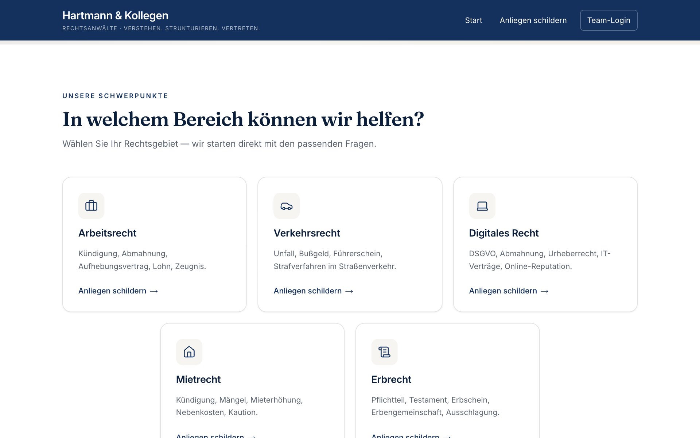 | 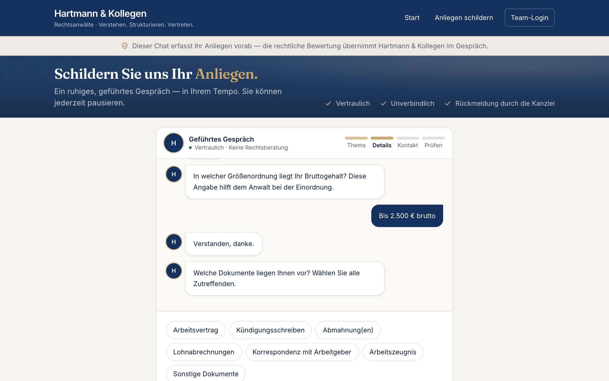 |
| 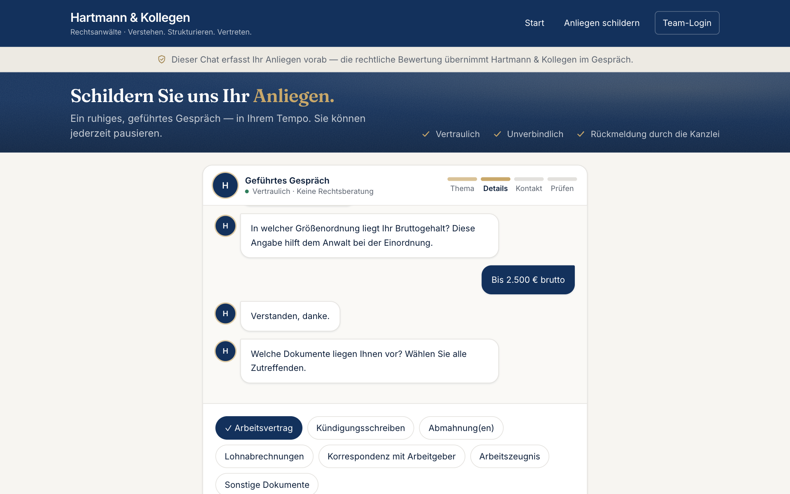 | 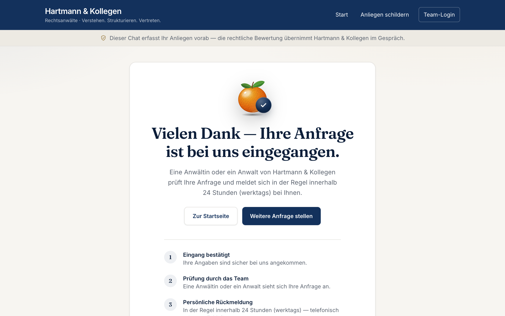 |
| 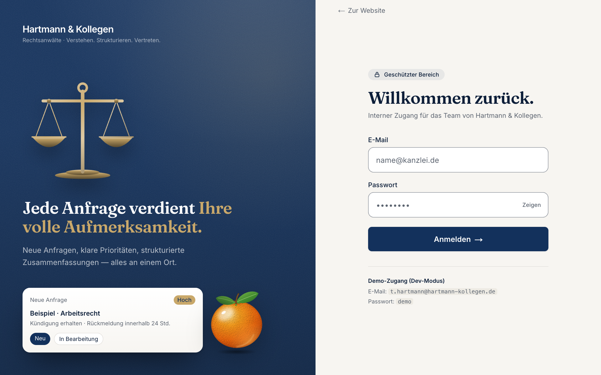 | 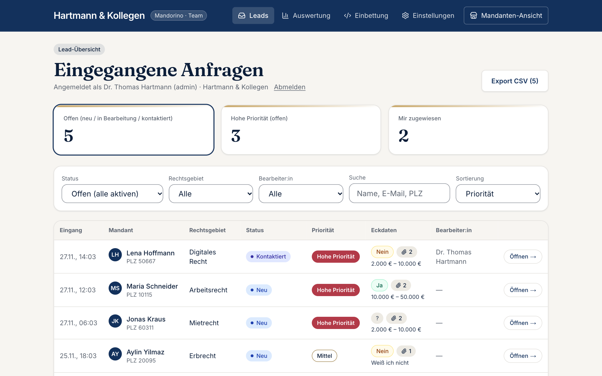 |
| 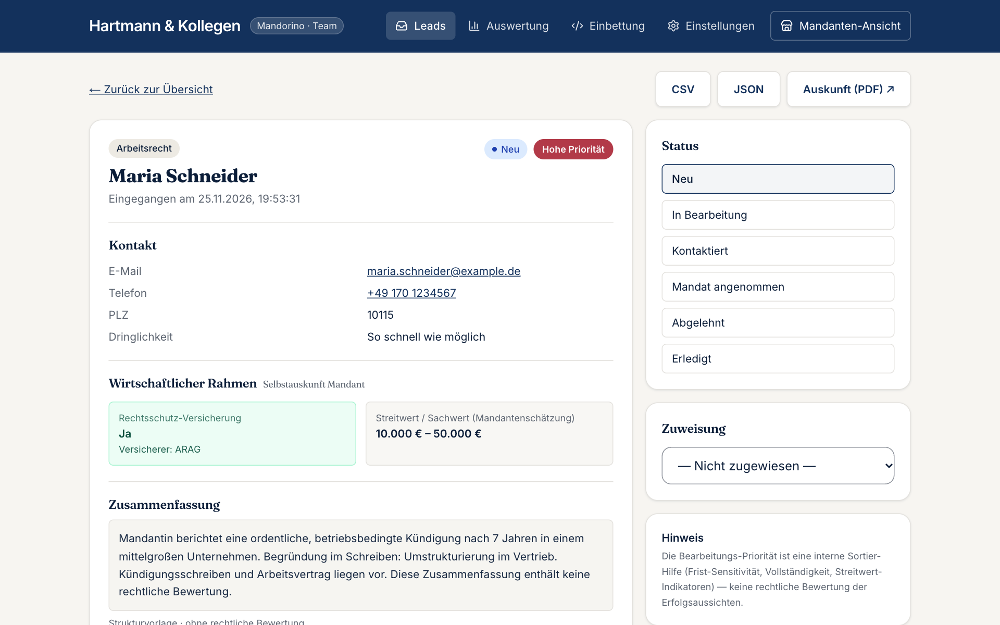 | 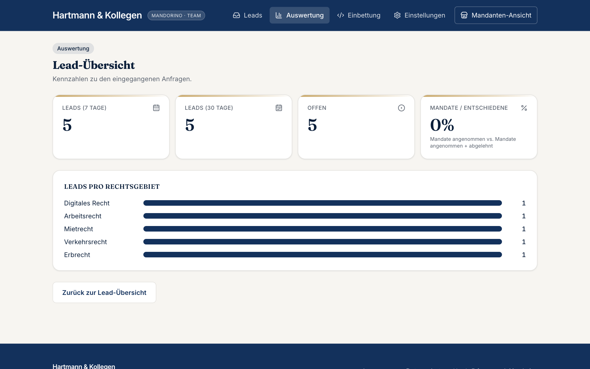 |

Mobil:

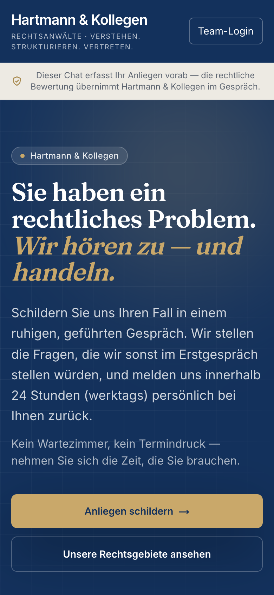 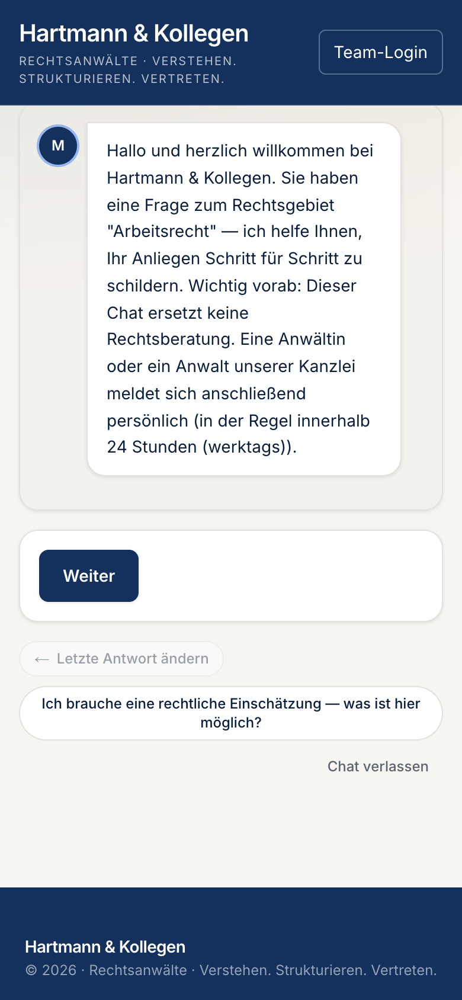 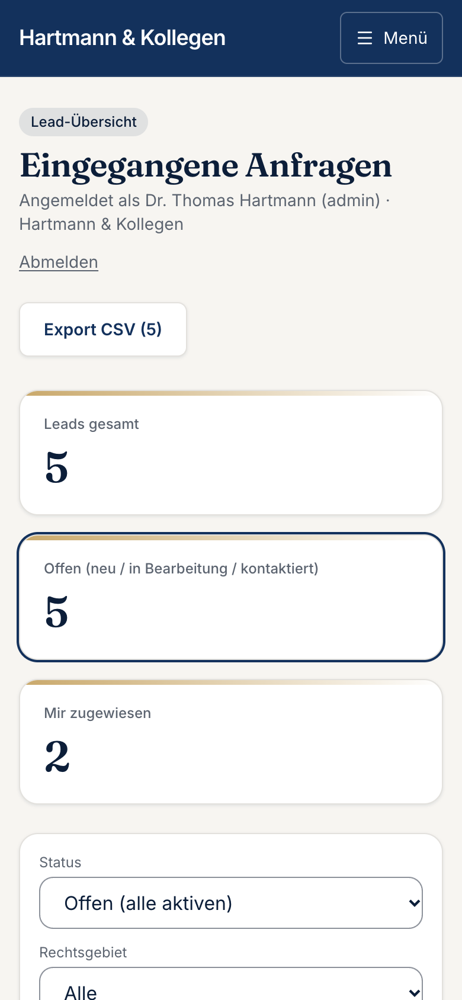

</details>

### In einer Minute lokal ausprobieren (ohne Konten)

```bash
git clone https://github.com/karam991/mandorino.git && cd mandorino
npm install
echo 'NEXT_PUBLIC_DEMO_MODE=1
NEXT_PUBLIC_DEMO_PASSWORD=demo' > .env.local
npm run dev
```

Dann http://localhost:3000 öffnen. Team-Login unter `/team/login` mit
`t.hartmann@hartmann-kollegen.de` und dem Passwort `demo` — beim ersten Aufruf liegen
5 Demo-Leads bereit. (Der Demo-Modus arbeitet nur mit Fake-Daten im Browser; die
Live-Demo nutzt dagegen echtes Supabase-Login.)

## Tech-Stack

- **Next.js 14** (App Router) + **TypeScript**
- **TailwindCSS** mit Brand-Theming via CSS-Variablen aus `tenant.config.ts`
- **KI-Zusammenfassung:** **Mistral** (EU-Anbieter) über die REST-API, Standardmodell
  `mistral-small-latest` (per `MISTRAL_MODEL` änderbar). Ohne `MISTRAL_API_KEY`
  oder bei einem Fehler läuft der **Template-Fallback** — der Chat funktioniert immer.
- **Persistenz:** **Supabase/Postgres** mit RLS (Produktiv) oder `localStorage`
  (Demo-Modus, nur mit Fake-Daten) — siehe „Persistenz + Auth".
- **Auth:** Supabase Auth mit Cookie-Session (`@supabase/ssr`); `middleware.ts`
  schützt `/team/*` serverseitig. Demo-Modus nur per explizitem Flag.
- **Tests:** Vitest (`npm test`) für Lead-Validierung, Signatur, Rate-Limit, Scoring.
- **E-Mail:** `nodemailer` (SMTP) als optionale Abhängigkeit; Slack / Teams / Webhook
  per HTTP.
- **Hosting:** Vercel.

`@supabase/supabase-js`, `@supabase/ssr` und `nodemailer` sind als `optionalDependencies`
eingetragen und werden per dynamischem Import geladen — fehlen sie, läuft das
System ohne Supabase bzw. SMTP weiter.

## Setup

```bash
npm install
cp .env.local.example .env.local   # alle Variablen sind optional
npm run dev
npm test                           # Unit-Tests (Vitest)
npm run typecheck
```

App unter http://localhost:3000. Ohne Umgebungsvariablen laufen Chat und Landing
lokal (Template-Zusammenfassung). Das **Team-Login ist dann gesperrt** — für lokale
Demos `NEXT_PUBLIC_DEMO_MODE=1` und `NEXT_PUBLIC_DEMO_PASSWORD=<passwort>` setzen
(siehe „Persistenz + Auth").

Wichtige Variablen (Details in `.env.local.example`):

| Variable | Zweck |
|---|---|
| `MISTRAL_API_KEY` / `MISTRAL_MODEL` | KI-Zusammenfassung (sonst Template-Fallback) |
| `SUPABASE_URL`, `SUPABASE_SERVICE_ROLE_KEY` | Server: Leads in die DB schreiben (**nie im Client**) |
| `NEXT_PUBLIC_SUPABASE_URL`, `NEXT_PUBLIC_SUPABASE_ANON_KEY` | Browser + Middleware: Supabase Auth fürs Team-Login |
| `MANDORINO_SIGNING_SECRET` | Signiert die KI-Zusammenfassung; ohne Secret wird sie serverseitig durch die Template-Variante ersetzt (**in Produktion setzen**) |
| `EMBED_ALLOWED_ORIGINS` | Komma-getrennte Kanzlei-Origins, die `/embed` und `/chat` einbetten dürfen; ungesetzt = jede Seite (**in Produktion setzen**) |
| `NEXT_PUBLIC_DEMO_MODE`, `NEXT_PUBLIC_DEMO_PASSWORD` | Demo-Modus ohne Supabase (nur Fake-Daten, Passwort ist öffentlich) |
| `SMTP_*` | E-Mail-Benachrichtigung |
| `SLACK_WEBHOOK_URL`, `TEAMS_WEBHOOK_URL`, `GENERIC_WEBHOOK_URL` | weitere Channels |
| `MANDORINO_PUBLIC_URL` | öffentliche URL (Links in Benachrichtigungen, Link-Vorschau) |

## White-Label-Konfiguration

Alles, was pro Kanzlei anders ist, lebt in `lib/tenant.config.ts`:

```ts
TENANT = {
  brand: { kanzleiName, tagline, logoUrl, primary, accent, mascot },
  legal: { impressumUrl, datenschutzUrl, rueckmeldungInnerhalb, provider: { name, street, ... } },
  practiceAreas: [ "arbeitsrecht", "verkehrsrecht", ... ],
  team: [ { id, name, email, role } ],  // Anzeige/Zuweisung — Zugriff regelt die DB-Tabelle tenant_team
  showStreitwertRangeForClient: false,  // Compliance-Toggle
  notifications: [ ... ],
}
```

- **Brand-Farben** werden im Layout als CSS-Variablen (`--brand-primary`,
  `--brand-accent`) gesetzt und über die Klassen `brand-bg` / `brand-text` /
  `brand-border` im UI verwendet.
- **Logo:** wenn `logoUrl` gesetzt, wird das Bild geladen, sonst Text-Fallback.
- **Maskottchen:** Die 3D-Mandarine gehört zu Mandorino und erscheint im Team-Login. Auf den
  öffentlichen Seiten (Landing, Danke) ist sie aus; eine Kanzlei kann sie mit
  `brand.mascot: true` einschalten.
- **Aktive Rechtsgebiete** werden auf der Landing automatisch als Karten
  gerendert und stehen im Chat als Themen-Auswahl zur Verfügung. Das Team kann
  sie unter `/team/settings` umschalten.
- **Team:** mehrere Accounts mit Rolle (`admin` / `bearbeiter`). `TENANT.team` liefert
  Anzeigenamen und IDs für das Zuweisungs-Dropdown. **Wer ins Dashboard darf, entscheidet
  ausschließlich die DB-Tabelle `tenant_team`** (Middleware + RLS). Passwörter stehen
  nicht im Code.
- **Impressum/Datenschutz:** `/impressum` und `/datenschutz` werden aus `legal.provider`
  erzeugt. Solange dort „[…]"-Platzhalter stehen, zeigen die Seiten einen sichtbaren
  „Entwurf"-Hinweis. Die Datenschutzerklärung nennt Dienstleister (Mistral, Supabase,
  SMTP) nur, wenn sie per Umgebungsvariable aktiv sind. **Der Text ist ein Entwurf und
  muss anwaltlich geprüft werden.**

## Rechtsgebiete

Jedes Rechtsgebiet ist ein eigenes Modul unter `lib/areas/`:

| Datei | Beschreibung (aus dem Code) |
|---|---|
| `arbeitsrecht.ts` | Kündigung, Abmahnung, Aufhebungsvertrag, Lohn, Zeugnis |
| `verkehrsrecht.ts` | Unfall, Bußgeld, Führerschein, Strafverfahren im Straßenverkehr |
| `digitales.ts` | DSGVO, Abmahnung, Urheberrecht, IT-Verträge, Online-Reputation |
| `mietrecht.ts` | Kündigung, Mängel, Mieterhöhung, Nebenkosten, Kaution |
| `erbrecht.ts` | Pflichtteil, Testament, Erbschein, Erbengemeinschaft, Ausschlagung |

Jedes Modul liefert (1) seinen eigenen Chat-Flow mit area-spezifischen Steps,
(2) eine Score-Funktion (`scorePriority`) für die Bearbeitungs-Priorität.
Über `lib/areas/registry.ts` werden die Module per ID adressiert.

### Neue Rechtsgebiete hinzufügen

1. `lib/areas/<neu>.ts` nach Vorlage anlegen.
2. In `lib/areas/registry.ts` den Eintrag ergänzen + `PracticeAreaId`-Typ erweitern.
3. In `tenant.config.ts` unter `practiceAreas` aktivieren.

## Bearbeitungs-Priorität (kein juristisches Erfolgs-Rating)

**Wichtig:** Der Score in `lead.priority` ist **kein Erfolgs-Rating**.
Er ist eine reine Geschäfts-Sortier-Hilfe (0–100). Ab 70 Punkten „hoch", ab 40
„mittel", sonst „niedrig". Einfluss auf den Score haben:

- **Frist-Sensitivität** — gebietsspezifisch (z. B. Arbeitsrecht: Kündigung
  ≤ 21 Tage her; Erbrecht: Ausschlagungsfrist; Digitales Recht: Datum des Schreibens)
- **Dokumenten-Vollständigkeit** — Anteil der genannten Unterlagen
- **Streitwert-Indikatoren** — Mandanten-Schätzung (Klassen), im Arbeitsrecht zusätzlich
  die Beschäftigungsdauer, im Erbrecht die Nachlassgröße
- **Mandanten-Dringlichkeit** (Eigenangabe)
- **Rechtsschutzversicherung** (Eigenangabe)

Die genaue Gewichtung steht in `lib/areas/_helpers.ts` und den Area-Modulen.
Im UI wird das als „Bearbeitungs-Priorität: hoch / mittel / niedrig"
angezeigt, **niemals** als „Erfolgsaussicht".

## Compliance-Architektur

Vier Ebenen halten das Tool von einer Rechtsdienstleistung fern:

1. **UI-Disclaimer** in Banner, Landing und Chat (`components/DisclaimerBanner.tsx`,
   `lib/disclaimer.ts`).
2. **Chat-Skript** — keine `botMessage()` formuliert eine Bewertung. Fragt der
   Mandant nach Einschätzung, antwortet der Bot mit `DISCLAIMER.userAskedForAdvice`.
3. **KI-System-Prompt** in `app/api/summarize/route.ts` — explizites Verbot
   von Bewertung/Erfolgsaussicht/Empfehlung.
4. **Template-Fallback** (`lib/templateSummary.ts`) — strikt deskriptiv.

> **Vor Launch unbedingt mit Anwalt prüfen:** Die optionale Anzeige der
> Streitwert-Range beim Mandanten (`showStreitwertRangeForClient`) ist per
> Default deaktiviert. Vor Aktivierung muss eine Anwältin/ein Anwalt die
> Formulierung freigeben. Ebenso offen: Datenschutz-Review (AVV, Hosting-Region,
> Prüfung des Entwurfs der Datenschutzerklärung und des Einwilligungstexts im Chat) —
> dieses Repo ist ein Demo/MVP, keine geprüfte Lösung.

## Demo-Zugänge

### Mandanten-Seite
- `/` → Landing mit Rechtsgebieten
- `/chat` → geführter Chatbot

### Team-Bereich
- `/team/login`
- **Demo-Modus (ohne Supabase):** nur mit `NEXT_PUBLIC_DEMO_MODE=1`. Alle Einträge aus
  `TENANT.team` (z. B. `t.hartmann@hartmann-kollegen.de`) melden sich mit dem gemeinsamen
  `NEXT_PUBLIC_DEMO_PASSWORD` an. Ohne Flag ist `/team/*` gesperrt.
- **Produktiv (mit Supabase):** Login über Supabase Auth. Die E-Mail muss unter
  *Authentication → Users* existieren **und** in der Tabelle `tenant_team` stehen —
  sonst leitet die Middleware auf den Login zurück.
- `/team/dashboard` → Lead-Liste mit Filter, Sortierung, Status, CSV-Export
- `/team/lead/[id]` → Detail mit Status-Wechsel, Zuweisung, Notizen, Historie
- `/team/lead/[id]/auskunft` → Druckansicht für DSGVO-Auskunftsersuchen (Art. 15)
- `/team/analytics` → schlanke KPI-Übersicht (bewusst minimal)
- `/team/settings` → aktive Rechtsgebiete verwalten
- `/team/embed` → Copy-Paste-Snippets für die Kanzlei-Website

Im Demo-Modus werden beim ersten Aufruf 5 Demo-Leads ins `localStorage` geschrieben.

> **Hinweis Supabase Free-Tier:** Projekte werden nach einiger Inaktivität
> pausiert. Solange ein Projekt pausiert ist, schlägt das Team-Login fehl.
> Vor Vorführungen im Supabase-Dashboard prüfen und ggf. fortsetzen.

## API-Schutz

Die öffentlichen Routen `/api/leads` und `/api/summarize` sind anonym erreichbar
(Mandanten sind nicht eingeloggt) und deshalb abgesichert (`lib/server/`):

- **Server baut den Lead selbst** (`leadInput.ts`): Der Client liefert nur
  Mandantenangaben (Rechtsgebiet, Kontakt, Dringlichkeit, …), jeweils mit Typ- und
  Längenprüfung. `id`, Zeitstempel, Status, Historie, Priorität und Rechtsgebiet-Label
  erzeugt der Server — gefälschte Client-Werte werden ignoriert. Einwilligung ist Pflicht.
- **Insert statt Upsert:** Eine bekannte ID kann keinen bestehenden Lead überschreiben.
- **KI-Zusammenfassung ist signiert** (`summarySignature.ts`): `/api/summarize` signiert
  die Antwort (HMAC, 2 h gültig); `/api/leads` übernimmt Client-Texte nur mit gültiger
  Signatur, sonst baut der Server die Template-Zusammenfassung.
- **Rate-Limit** pro IP (Leads: 8 / 10 Min., Summarize: 20 / 10 Min.) und pro
  Mandanten-E-Mail (3 / Std.) → HTTP 429. Die IP kommt aus dem Plattform-Header
  (`x-vercel-forwarded-for` / `x-real-ip`), sonst aus dem rechtesten `x-forwarded-for`-Eintrag.
- **Größenlimit** 64 KB pro Request → HTTP 413.
- **Keine stille Datenverlust-Antwort:** Ist Supabase konfiguriert, das Speichern
  fehlgeschlagen und kein Benachrichtigungs-Channel hat zugestellt, antwortet die Route
  mit 500 — der Chat zeigt dann einen Fehler statt der Danke-Seite.
- **Generische Fehlermeldungen** — Details nur im Server-Log.
- **Security-Header** auf allen Routen; `/team/*` ist nicht einbettbar
  (`frame-ancestors 'self'`). `/chat` und `/embed` (inkl. `/embed/danke`) sind nur für
  die Domains aus `EMBED_ALLOWED_ORIGINS` einbettbar (ungesetzt: jede Seite).

## Projekt-Struktur

```
app/
├─ page.tsx                          # Landing (dynamisch aus tenant.config)
├─ layout.tsx                        # Fonts, Metadata, Skip-Link
├─ chat/page.tsx                     # Chatbot (Mandanten-Seite mit Header/Footer)
├─ embed/                            # Iframe-/Widget-Modus (ohne Header/Footer)
│  ├─ layout.tsx                     # Minimal-Layout
│  ├─ page.tsx                       # Chatbot + postMessage-Resize
│  └─ danke/page.tsx                 # Bestätigung im Embed
├─ danke/page.tsx                    # Bestätigung (Vollseite)
├─ impressum/page.tsx                # Impressum (aus legal.provider, Entwurf-Hinweis)
├─ datenschutz/page.tsx              # Datenschutzerklärung (Entwurf, aktive Dienstleister)
├─ not-found.tsx / error.tsx         # 404- und Fehlerseite
├─ icon.svg / opengraph-image.tsx    # Favicon + Link-Vorschau (aus der Tenant-Config)
├─ team/
│  ├─ login/page.tsx
│  ├─ dashboard/page.tsx             # Liste, Filter, Sort, Status
│  ├─ lead/[id]/page.tsx             # Detail + Workflow
│  ├─ lead/[id]/auskunft/page.tsx    # Druckansicht DSGVO-Auskunft
│  ├─ analytics/page.tsx             # Schlanke KPIs
│  ├─ settings/page.tsx              # Rechtsgebiete an/aus
│  └─ embed/page.tsx                 # Copy-Paste-Snippets für Kanzlei-Website
└─ api/
   ├─ summarize/route.ts             # Mistral-API + Template-Fallback
   └─ leads/route.ts                 # Lead-POST → Notifications + (opt.) Supabase

middleware.ts                        # Serverseitiger Schutz von /team/* (Session + tenant_team)
tests/                               # Vitest: leadInput, guard, priority
vitest.config.ts

public/
└─ widget.js                         # Drop-in-Script (Floating-Button + Overlay)

components/                          # Header, Footer, LegalPage, DisclaimerBanner, Logo,
                                     # Reveal, ChatBubble, ChatContainer, QuickReplyChips,
                                     # StatusPill

lib/
├─ tenant.config.ts                  # White-Label-Konfig (Brand, Areas, Team, Notif.)
├─ tenantOverrides.ts                # Zur Laufzeit änderbar: aktive Rechtsgebiete
├─ types.ts                          # Lead, LeadDraft, LeadStatus, Historie
├─ chatFlow.ts                       # Globale Steps + Area-Auflösung
├─ leadStore.ts                      # localStorage-CRUD + Demo-Seed (nur Demo-Modus)
├─ clientLeads.ts                    # Async Lead-Zugriff fürs Dashboard (Supabase/RLS oder Demo)
├─ authStore.ts                      # Login (Supabase Auth oder Demo-Modus), Whitelist = tenant_team
├─ supabaseClient.ts                 # Browser-Supabase-Client (Cookie-Session, lazy) + isDemoMode
├─ exportLead.ts                     # CSV-Export
├─ templateSummary.ts                # Generische Fallback-Zusammenfassung
├─ disclaimer.ts                     # White-Label-Disclaimer-Texte
├─ constants.ts                      # Standard-Modell der KI-Zusammenfassung
├─ server/guard.ts                   # Rate-Limit + Größenlimit für API-Routen
├─ server/leadInput.ts               # Validierung + serverseitiger Lead-Aufbau
├─ server/summarySignature.ts        # HMAC-Signatur der KI-Zusammenfassung
├─ areas/                            # Practice-Area-Plugins
│  ├─ types.ts / _helpers.ts / registry.ts
│  └─ arbeitsrecht.ts / verkehrsrecht.ts / digitales.ts / mietrecht.ts / erbrecht.ts
├─ notifications/                    # Pluggable Channels
│  ├─ types.ts                       # NotificationChannel + Configs
│  ├─ format.ts                      # Gemeinsame Body-Formatierung
│  ├─ dispatch.ts                    # Channel-Builder + Fan-out
│  └─ channels/                      # Email / Slack / Teams / Webhook
└─ repos/                            # Repository-Pattern für Persistenz
   ├─ leadRepo.ts                    # Interface
   └─ supabaseLeadRepo.ts            # Supabase-Impl (lazy import)

supabase/
└─ schema.sql                        # leads, tenant_team, tenant_settings + RLS-Policies
```

## Pricing (Arbeits-Annahme)

Reine Planungsannahme, nicht validiert:

- **Erste Kanzlei: kostenfrei** gegen Compliance-Check (AGB, Datenschutz,
  AVV, Disclaimer-Review, Score-/Range-Logik).
- Reguläre Kanzleien:
  - **Setup-Fee einmalig: 1.499 €** (Onboarding, Branding, Schulung)
  - **SaaS-Pauschale: 149 €/Monat** (Hosting, Updates, Support, ~100 Leads inkl.)
  - **Über-Volumen: 1 €/Lead** (deckt KI-Token komfortabel)
  - **12-Monats-Mindestlaufzeit** im ersten Jahr

## Einbettung auf der Kanzlei-Website

Mandorino läuft als eigenständige Anwendung. Die Beispiele unten verwenden die
Platzhalter-Domain `kanzlei.mandorino.app` — im Betrieb die eigene Domain
einsetzen (Demo: `https://mandorino.vercel.app`). Die Kanzlei bindet das Widget auf
ihrer eigenen Website auf zwei Arten ein:

**Variante A — Floating-Button (Drop-in-Script):**

```html
<script src="https://kanzlei.mandorino.app/widget.js"
        data-mandorino-base="https://kanzlei.mandorino.app"
        data-button-text="Anliegen schildern"
        data-button-color="#0F4C81"
        data-position="br"
        defer></script>
```

Optional: `data-auto-open="1"` öffnet das Overlay sofort.

**Variante B — Inline-Iframe** (für eine eigene `/kontakt`-Seite):

```html
<iframe src="https://kanzlei.mandorino.app/embed"
        style="border:0;width:100%;min-height:640px"></iframe>
```

Im Team-Bereich unter `/team/embed` gibt es Copy-Paste-Snippets mit den
brand-spezifischen Farben automatisch eingesetzt. Das Iframe meldet seine
Höhe per `postMessage` zurück, das Drop-in-Script passt es automatisch an.

## Notifications — Email, Slack, Teams, Webhook

Eingehende Leads werden parallel an alle in `tenant.config.notifications`
konfigurierten Channels gepusht. Jede Kanzlei kann beliebig kombinieren:

```ts
notifications: [
  { kind: "email", label: "Sekretariat", to: ["leads@kanzlei.de"] },
  { kind: "slack", label: "#leads",  webhookUrl: process.env.SLACK_WEBHOOK_URL! },
  { kind: "teams", label: "Team",    webhookUrl: process.env.TEAMS_WEBHOOK_URL! },
  { kind: "webhook", label: "n8n",   url: process.env.GENERIC_WEBHOOK_URL! },
]
```

| Channel | Setup |
|---|---|
| **Email (SMTP)** | `SMTP_HOST/PORT/SECURE/USER/PASS/FROM` in `.env.local`. Outlook: `smtp.office365.com:587`, Gmail: `smtp.gmail.com:587` (App-Password). |
| **Slack** | Slack-App → Incoming Webhooks → Webhook im Ziel-Channel anlegen → URL in Tenant-Config. |
| **Teams** | Channel → „…" → Connectors → Incoming Webhook → URL in Tenant-Config. |
| **Webhook** | Beliebiger HTTP-Endpoint (Zapier, Make, n8n, eigenes CRM). |

**Microsoft Graph** (OAuth-basiert, ohne SMTP-Passwort) ist als zweiter
Email-Transport vorgesehen — kommt nach Launch.

Channel-Fehler sind nicht-blockierend: ein kaputter Slack-Webhook verhindert
nicht, dass der Lead im Dashboard erscheint.

## Persistenz + Auth — Supabase (Produktiv) ↔ Demo-Modus

| Modus | Aktivierung | Persistenz | Auth |
|---|---|---|---|
| **Produktiv** | `SUPABASE_*` + `NEXT_PUBLIC_SUPABASE_*` gesetzt | Supabase-DB mit RLS; Dashboard liest/schreibt mit dem JWT der eingeloggten Person | Supabase Auth, Cookie-Session, `middleware.ts` + Tabelle `tenant_team` |
| **Demo** | `NEXT_PUBLIC_DEMO_MODE=1`, **kein** Supabase | `localStorage` im Browser (Fake-Daten) | gemeinsames `NEXT_PUBLIC_DEMO_PASSWORD` (öffentlich!) |
| *(nichts gesetzt)* | — | — | `/team/*` gesperrt (fail closed) |

### Setup

```bash
# 1. Supabase-Projekt anlegen (https://supabase.com)
# 2. SQL-Editor öffnen → supabase/schema.sql ausführen
#    → erstellt leads, tenant_team (Whitelist), tenant_settings + RLS-Policies
# 3. Settings → API:
#      service_role Key  → SUPABASE_SERVICE_ROLE_KEY (server-only!)
#      anon public Key   → NEXT_PUBLIC_SUPABASE_ANON_KEY
#      Project URL       → SUPABASE_URL + NEXT_PUBLIC_SUPABASE_URL
# 4. (kein extra Schritt — @supabase/supabase-js ist als optionalDependency enthalten)
# 5. Authentication → Users → "Add user" → E-Mail/Passwort jedes
#    Team-Mitglieds anlegen, "Auto-confirm email" aktivieren
#    (Supabase-Standard: Passwort mindestens 6 Zeichen)
# 6. SQL-Editor → tenant_team-Whitelist befüllen (Pflicht — sonst sieht der
#    Benutzer trotz Login keine Leads), z. B.:
#      insert into public.tenant_team (email, name, role) values
#        ('admin@hartmann-kollegen.de', 'Admin', 'admin')
#      on conflict (email) do nothing;
# 7. Optional: dieselbe Person in tenant.config.ts → TENANT.team eintragen
#    (nur für Anzeigename/ID im Zuweisungs-Dropdown; Zugriff regelt tenant_team).
#    Keine Passwörter in den Code schreiben.
# 8. MANDORINO_SIGNING_SECRET und EMBED_ALLOWED_ORIGINS setzen (siehe Tabelle oben).
```

### Sicherheitsmodell

- **Mandanten-Eingang** (`/chat`, `/embed`): anonym, schreibt via `/api/leads` mit der
  Service-Role in `leads`. Direkter Anon-INSERT ist per RLS nicht erlaubt (keine
  INSERT-Policy). Die Route validiert und baut den Lead serverseitig (siehe „API-Schutz").
  Im Supabase-Modus landen **keine** Mandantendaten im localStorage des Besuchers.
- **Team-Dashboard**: Browser-Anon-Key + Supabase-JWT; RLS-Policy `is_team_member()`
  entscheidet. `middleware.ts` prüft zusätzlich serverseitig Session (`getUser()`) und
  Eintrag in `tenant_team`. Der localStorage-Eintrag im Browser ist nur ein UI-Cache und
  gewährt keinen Zugriff.
- **Rollen:** `admin` / `bearbeiter` unterscheiden sich bisher nur bei `tenant_settings`
  (Schreiben nur Admin). Auf `leads` haben beide Rollen dieselben Rechte.
- **Historie** wird atomar per SQL-Funktion `append_lead_history` angehängt
  (in `supabase/schema.sql`).
- **Service-Role-Key** liegt ausschließlich auf dem Server (Vercel-Env),
  nie im Client-Bundle.
- **Historischer Bezeichner:** Das Feld `ai_summary_source` kennt die Werte
  `'claude'` und `'template'`. `'claude'` steht heute für „KI-Zusammenfassung"
  (Provider: Mistral) und bleibt, weil der Wert im DB-Check-Constraint
  festgeschrieben ist — eine Umbenennung bräuchte eine Migration.

## Deployment (Vercel)

1. Repo mit Vercel verbinden; ein Push auf `main` löst ein Production-Deployment aus,
   andere Branches erhalten Preview-Deployments.
2. Umgebungsvariablen unter *Project → Settings → Environment Variables* setzen
   (siehe Tabelle im Abschnitt „Setup").
3. Nach dem Deploy: Supabase-Projekt nicht pausiert? Einmal Login + kompletten Chat testen.

## Bekannte Grenzen

- **Rate-Limit ist in-memory** (pro Serverless-Instanz) und bremst nur Skripte; kein
  Captcha/Honeypot. Für Produktion: verteilter Limiter (Upstash Redis) + Bot-Challenge.
- **`/api/summarize` ist anonym** und verursacht Kosten pro Aufruf (nur IP-limitiert).
- **Keine automatische Löschung:** Aufbewahrungsfristen sind nicht technisch erzwungen;
  Löschung und Auskunft laufen manuell (Auskunfts-Druckansicht im Dashboard).
- **Kein Audit-Log auf DB-Ebene:** Die Historie ist ein JSONB-Feld am Lead, kein
  manipulationssicheres Protokoll.
- **Impressum/Datenschutz sind Entwürfe** und nicht rechtlich geprüft.
- **Lint ist nicht eingerichtet** (`npm run lint` startet nur den interaktiven Next-Assistenten).

## Spätere Schritte (out-of-scope für diesen MVP)

- **Verteiltes Rate-Limit** (z. B. Upstash Redis) statt In-Memory
- **2FA** für Admin-Rolle (Supabase Auth unterstützt TOTP nativ — UI fehlt noch)
- **Microsoft Graph** als zweiter Email-Transport (OAuth, ohne SMTP-Passwort)
- **Datei-Uploads** (Kündigungsschreiben, Fotos, Dokumente) → Supabase Storage
- **Erweiterte Analytics** (Funnel, Reaktionszeiten, Lead-Quellen)
- **Stripe-Subscription** für die SaaS-Pauschale
- **Streitwert-Range-Anzeige** beim Mandanten (nach Anwaltsprüfung)
- **Web-Component-Variante** (Custom Element ohne Iframe) für tiefere Integration
- **Rechtliche und Datenschutz-Prüfung** durch eine Anwältin/einen Anwalt vor dem Echtbetrieb
